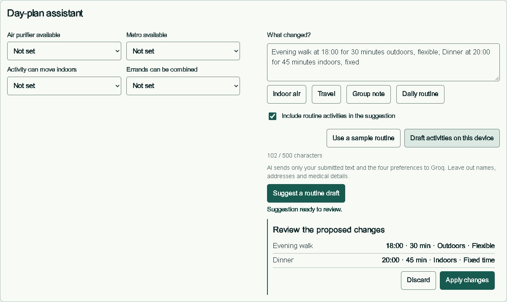
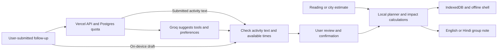

# AirDaybook

AirDaybook is an offline-first urban air quality planner for families and community groups navigating winter smog. Check a dated local reading, compare daily routines and travel options, size a room’s air filtration, and draft an English or Hindi group note. The live Groq assistant suggests tools, preference changes and routine activities for you to review.

[Live demo](https://airdaybook.vercel.app/) · [Linux release checks](https://github.com/NoorRattan/AirDaybook/actions/workflows/release-check.yml) · [Hosted release checks](https://github.com/NoorRattan/AirDaybook/actions/workflows/hosted-release.yml)


## Try the demo

1. On **Today**, choose **Try historical replay** to load the 6 November 2026 Delhi example. For your own plan, use **Enter a reading** or **Import JSON**. The selected reading shows its date and source.
2. Open **My Plan**. Enter 15 minutes for the current outdoor wait and 5 for the revised wait. The comparison shows **10 min less outside**, with the 3 pm pickup still in place.
3. In **Day-plan assistant**, try “We don’t have a purifier. What can we do about indoor air?” or choose **Use a sample routine** to see how activity drafting works. Review the proposal before applying it. **Draft activities on this device** works offline.
4. Open **Travel** to compare door-to-door routes. With the average motorized road-trip baseline selected, a 12 km Delhi Metro trip shows an estimated **0.29–0.39 kg CO₂ avoided**. Use **Group note** to copy a dated summary.



The app accepts manual and historical readings and labels model estimates separately. **Explore 3D** opens a neighbourhood illustration with still viewpoints available offline or when WebGL is unavailable.

| Planning task | What you can compare |
| --- | --- |
| Daily routines | Keep fixed commitments and see how much outdoor or strenuous time a flexible indoor activity could avoid. |
| Indoor air | Compare smoke source control, filter options and the estimated particle CADR for a room. |
| Travel | Compare door-to-door time, outdoor waiting, travel cost and supported emissions estimates. |
| Community | Review an English or Hindi note with a dated reading and project repeated trip changes across a group. |



## Run locally

Use Node.js 24 and npm.

```sh
npm ci
npm run dev
```

Open [localhost:3000](http://localhost:3000). The website uses Next.js App Router, React, TypeScript, and React Three Fiber. IndexedDB stores readings and drafts locally. To test offline mode, run the production build below.

## Day-plan assistant

The manual planner works with AI disabled. To enable Groq, configure these variables in the server process. Store the credential in your local environment or hosting secret store.

| Variable | Value |
| --- | --- |
| `APP_ORIGIN` | Exact browser origin, such as `http://localhost:3000` locally or your HTTPS origin in staging |
| `RELEASE_ID` | Revision or image identifier written to redacted operational logs |
| `AI_ENABLED` | `true` to enable suggestions |
| `GROQ_API_KEY` | The server-side Groq credential |
| `GROQ_MODEL` | Defaults to `openai/gpt-oss-20b` |
| `AI_DAILY_LIMIT` | Positive daily cap on upstream requests |
| `AI_MAX_CONCURRENT` | Positive cap on simultaneous requests |
| `AI_BURST_PER_MINUTE` | Positive cap on requests per minute |
| `AI_CLIENT_DAILY_LIMIT` | Optional Vercel allowance per client. Defaults to up to three per Indian calendar day, bounded by the global allowance. |
| `AI_QUOTA_DB_PATH` | Absolute path to a SQLite database in an existing writable directory |
| `AI_QUOTA_DATABASE_URL` | Shared Postgres quota database on Vercel. Also reads the integration's `DATABASE_URL` or `POSTGRES_URL`. |
| `AI_PROVIDER_TIMEOUT_MS` | Optional deadline in milliseconds, defaults to 8000 |

Groq proposes edits to four preferences and can route a request to the routine, indoor air, travel or group-note tool. AirDaybook extracts up to four activities directly from submitted text and screens them for conflicts with saved times. Provide a name, start time, duration in minutes, and indoor or outdoor setting for each activity, with one activity per line or separated by semicolons. Both preference and routine edits require confirmation. Fixed commitments, saved routines, readings and group notes stay in the browser. SQLite coordinates short-lived and daily reservations for processes on the same writable disk. Postgres coordinates them across instances. Vercel enforces a separate allowance for each client recognized by its ingress.

## Verify

```sh
npm run typecheck
npm run lint
npm test
npm run build
npm run test:api
```

The domain tests cover reading provenance, fixed commitments, IndexedDB storage, impact calculations, and the model response contract. Use `npm run test:coverage` to see coverage for the domain modules. The API suite runs a production standalone server and uses temporary quota storage with a local provider fixture. Set `AIRDAYBOOK_TEST_POSTGRES_URL` to a disposable local PostgreSQL service to include the production adapter checks.

Build and start the same standalone Linux image used by GitHub Actions.

```sh
docker build --platform linux/amd64 -t airdaybook .
docker run --rm -p 127.0.0.1:3000:3000 -e AI_ENABLED=false airdaybook
```

`GET /api/health` reports core app readiness. If you enable AI with SQLite in Docker, mount a writable volume at `/var/data` and set `AI_QUOTA_DB_PATH` to a file there.

With the production server running, use `node scripts/smoke-release.mjs http://127.0.0.1:3000` to verify both routes and the offline assets. Install Chromium with `npx playwright-core install chromium`, then run `npm run test:browser`. The browser suite checks keyboard focus, axe WCAG checks for opened tools, edits from two tabs, offline editing, unsafe reading URLs, the Metro estimate, bilingual notes, and WebGL fallbacks. Set `AIRDAYBOOK_TEST_ORIGIN` if the server uses a different origin. GitHub Actions verifies the domain and API contracts on Node 24 and runs the smoke and browser tests against the Linux image.

## Deploy the free preview on Vercel

Import the GitHub repo into a Vercel Hobby workspace with Next.js as the preset. Use Node.js 24 and `npm run build` so deployment includes the generated offline worker. Manual mode can deploy without environment variables. To enable AI on Vercel, attach a shared Postgres database such as Neon Free, save `GROQ_API_KEY` as a sensitive server-side variable, and set `AI_ENABLED=true` and the three AI limits. The production domain can be inferred from Vercel's system environment variables or set explicitly with `APP_ORIGIN`.

The Postgres adapter creates quota tables for global daily counts, short-lived requests, and per-client daily counts. It stores a keyed digest of the address Vercel supplies at ingress. IPv6 addresses share their /64 network allowance. The app also limits each client’s rolling-minute requests. Local AI accepts loopback development origins. Quota failures leave the manual planner available. Verify the HTTPS release with `node scripts/smoke-release.mjs` followed by the deployment origin.

Use `ai_configuration` events to check whether the server accepted its runtime settings. Use `plan_revision` events to distinguish provider failures, timeouts, quota-store failures, and usage limits. The core health endpoint stays independent of AI.

The weekly production workflow checks core health, the public AI availability endpoint and institutional citation URLs. A connection timeout from the hosted runner to CPCB calls for a check from another network. See the [security policy](SECURITY.md) for the private reporting channel.

## Offline planner

Open either page on the local production image or an HTTPS deployment. Wait for **Available offline** in the footer. Both pages, the Delhi replay, reading imports, routine edits, route comparisons and community notes work offline. Drafts stay in IndexedDB. AI and new city estimates require a connection. City estimates come from the CAMS model through Open-Meteo and are labeled separately from station measurements.

The production build emits the versioned service worker. An installed update offers **Load saved update** once its complete shell has been downloaded and checked. The existing shell remains available while the next version installs.
